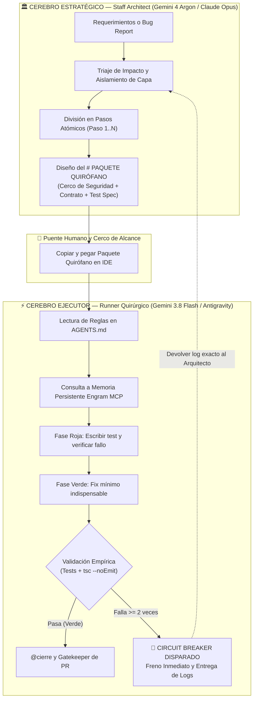
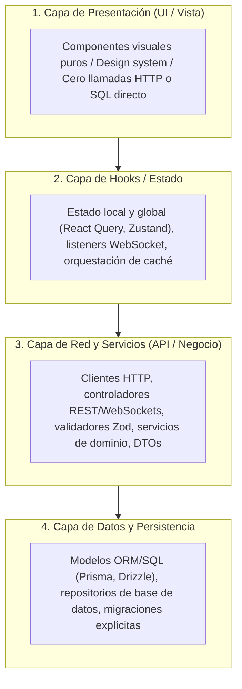

<div align="center">

# Gentle AI Harness 🛡️⚡
### El Sistema Operativo Quirúrgico Multi-Agente para Desarrolladores Solo

<p align="center">
  <a href="./README.md"></a>
  <a href="./README.es.md"></a>
</p>

[](#-arquitectura-por-perfil-de-proyecto)
[](#-el-patr%C3%B3n-one-man-engineering-team)
[](https://github.com/gentle-ai)
[](#-protocolo-de-ejecuci%C3%B3n-quir%C3%BArgica)
[](#-anti-token-maxing-y-cerco-de-seguridad)
[](https://opensource.org/licenses/MIT)

</div>

> [!TIP]
> 🌐 **Read this in other languages / Leer en otros idiomas:**
> * 🇪🇸 **[Español (README.es.md)](./README.es.md)** — Documentación completa en Español
> * 🇺🇸 **English (README.md)** — Default English version

> **"Basta de ver cómo las bases de código asistidas por IA colapsan por quema descontrolada de tokens, diffs alucinados y degradación arquitectónica. Gentle AI Harness une un Staff Architect en la nube con un ejecutor local quirúrgico mediante cercos de seguridad inmutables, TDD determinista y memoria persistente."**

**Gentle AI Harness** es un framework operativo y contrato de ingeniería diseñado para transformar a un desarrollador individual en un equipo de ingeniería completo, resiliente y de nivel enterprise. Al desacoplar la **Arquitectura Estratégica de Sistemas** de la **Ejecución Quirúrgica de Código**, el harness elimina de raíz los mayores problemas del desarrollo con IA: agotamiento de contexto, diffs gigantescos, rotura de contratos y contaminación entre capas.

---

## ⚡ El Problema Real: Por Qué la IA Convencional Rompe Proyectos

La mayoría de los desarrolladores interactúan con la IA como si fuera un ejecutor monolítico: pegan una tarea entera, dejan que el modelo lea decenas de archivos y rezan para que el código compile. A medida que el proyecto crece, esto genera cuatro fallos críticos:

1. **Token Maxing y Alucinación:** Los modelos leen cientos de archivos innecesarios, consumen el contexto y pierden de vista las invariantes del dominio.
2. **Deriva de Contexto (Context Drift):** A medida que la conversación avanza, las directivas y reglas se olvidan o se sobreescriben silenciosamente.
3. **Contaminación de Capas:** Agentes sin cerco mezclan queries SQL dentro de componentes de UI, se saltan validaciones y exponen variables de entorno.
4. **Bucles Infinitos de Arreglos:** Cuando un test o el typechecker falla, el agente prueba parches a ciegas, degradando el código hasta arruinar la rama.

**Gentle AI Harness resuelve esto estructuralmente mediante ejecución acotada, contratos estrictos y una topología de doble cerebro.**

---

## 🧠 El Patrón "One-Man Engineering Team"

El harness distribuye la carga cognitiva en dos roles hiperespecializados coordinados por el desarrollador:



| Dimensión | Asistentes de Chat Monolíticos | Auto-Devs Autónomos Ciegos | **Gentle AI Harness** |
| :--- | :--- | :--- | :--- |
| **División Cognitiva** | 1 modelo hace arquitectura y código | Agentes corriendo en bucle | **Staff Architect (Argon) + Runner Quirúrgico (Flash)** |
| **Consumo de Tokens** | Agota la ventana rápidamente | Altísimo costo en tokens | **Minimalista / Anti-Token Maxing (`rg` + Engram MCP)** |
| **Límite de Alcance** | Lectura/escritura libre de archivos | Contenedor sin cerco estricto | **Cerco de Seguridad estricto (Whitelist única)** |
| **Freno Anti-Bucle** | Adivina parches hasta romper la rama | Reinicia todo el pipeline | **Circuit Breaker: frena tras 2 fallos consecutivos** |
| **Memoria Persistente** | Se pierde al cerrar el chat | Caché volátil de sesión | **Grafo persistente con Engram MCP** |
| **Rigor de Capas** | Código espagueti | Límites inconsistentes | **Arquitectura por perfil de proyecto (`production` / `mvp`)** |

---

## 🏛️ Arquitectura por Perfil de Proyecto

El perfil se detecta automáticamente en `@init` y condiciona las reglas de capas:

**Perfil `production`** (proyectos con > 10 archivos de lógica) — separación estricta en 4 capas, obligatoria:



1. **Capa 1 (UI / Vista):** Presentación visual pura. **Prohibido incluir llamadas HTTP directas o lógica de negocio compleja.**
2. **Capa 2 (Hooks / Estado):** Manejo de estado local/global, sockets o caché de consultas.
3. **Capa 3 (Red / Servicios / API):** Clientes HTTP, endpoints, servicios de dominio, esquemas Zod y DTOs.
4. **Capa 4 (Datos / Persistencia):** Modelos ORM/SQL, repositorios y migraciones explícitas.

**Perfil `mvp`** (proyectos con ≤ 10 archivos de lógica) — las capas 1-2 pueden colapsar en un componente con estado local; las capas 3-4 pueden unificarse en un service plano. Se gradúa a `production` automáticamente al superar el umbral o por declaración explícita (`@perfil production`).

> **Limitación conocida — el Puente Humano:** el flujo Arquitecto → Ejecutor requiere que el desarrollador copie y pegue los Paquetes Quirófano manualmente. Es un trade-off consciente: control quirúrgico sobre velocidad bruta. Para cambios triviales, usá `@quick` para saltear el ritual.

---

## 🛡️ Anti-Token Maxing y Cerco de Seguridad

El harness impone las directivas estrictas detalladas en [`AGENTS.md`](./AGENTS.md):

* **Memoria Primero (`Engram MCP`):** Consulta el grafo arquitectónico persistente antes de tocar el sistema de archivos.
* **Cerco de Seguridad Estricto:** El agente local opera bajo tres scopes distintos, nunca mezclados:
  * **Scope de modificación:** archivos que el agente puede leer y escribir (declarados en el Paquete Quirófano).
  * **Scope de solo lectura:** archivos de contratos/tipos que puede consultar pero nunca modificar.
  * **Scope de validación:** comandos globales (`tsc --noEmit`, suite completa de tests) que se ejecutan contra todo el proyecto sin otorgar al agente permisos de modificación fuera del cerco.
* **Búsqueda Quirúrgica:** Rastreo de llamadas mediante herramientas de alta velocidad (`rg`, `grep -rn`) buscando nombres de funciones o tipos puntuales, sin abrir archivos enteros para explorar.
* **Circuit Breaker (Freno Anti-Bucle):** Si tras implementar un cambio un test o `npx tsc --noEmit` falla **2 veces consecutivas**, la ejecución se DETIENE de inmediato. Prohibido probar parches por fuerza bruta.
* **Límites Inalterables:**
  * Prohibido commitear en `main` (siempre ramas `feature/` o `bugfix/`).
  * Prohibido instalar paquetes en `package.json` sin autorización expresa.
  * Prohibido alterar `.env` o filtrar credenciales.
  * Prohibido alterar esquemas de base de datos sin migraciones explícitas.

---

## ⚡ Comandos de Enrutamiento Dinámico (`AGENTS.md`)

El harness utiliza **Lazy Loading de Prompts**: los archivos de `.ai/` nunca se leen al inicio de la sesión ni por curiosidad; solo se activan cuando el usuario ingresa su comando disparador:

| Comando | Agente / Workflow | Acción Realizada |
| :--- | :--- | :--- |
| `@init` | `.ai/workflows/00-init-gentle.md` | Inicializa Engram y extrae la radiografía completa del repositorio. |
| `@bug [error/detalle]` | `impact-scout.md` + `01-pack-bug.md` | Rastrea con `rg` y genera el paquete de diagnóstico del bug. |
| `@feature [idea]` | `impact-scout.md` + `02-pack-feature.md` | Mapea dependencias cruzadas y genera el paquete de la feature. |
| `@db [cambio]` | `03-db-migration.md` | Extrae esquemas y planifica migraciones reversibles zero-downtime. |
| `@refactor [ruta]` | `04-refactor-aislado.md` | Refactoriza un módulo garantizando 100% de invarianza externa. |
| `@cierre` o `@pr` | `code-reviewer.md` + `05-gatekeeper-pr.md` | Audita `git diff`, corre regresión global y genera el Pull Request. |
| `@quick [descripción]` | Fix directo mínimo | Solo para cambios de **bajo riesgo semántico** (copy, estilos, labels). Saltea el ritual TDD. El agente confirma el diff antes de commitear. |
| `# PAQUETE QUIRÓFANO` | Sección 3 Reglas de Oro | Activa la ejecución TDD quirúrgica bajo el cerco recibido. |

---

## 📦 Estructura de un Paquete Quirófano (`# PAQUETE QUIRÓFANO`)

Formato emitido por el Staff Architect para ser ejecutado por el agente local:

```markdown
# PAQUETE QUIRÓFANO — [TÍTULO DE LA TAREA / PASO X de Y]

## 1. RAMA Y CONTEXT SCOPE (CERCO DE SEGURIDAD ESTRICTO)
- **Rama Git:** `feature/auth-session-recovery`
- **Consulta Engram:** nodo `auth-service`
- **ARCHIVOS DENTRO DEL ALCANCE (Lectura/Escritura):**
  - `src/services/auth.service.ts`
  - `src/services/auth.service.test.ts`
- **ARCHIVOS DE SOLO LECTURA (Contratos):**
  - `src/types/auth.types.ts`
- **ARCHIVOS PROHIBIDOS:** Prohibido abrir, leer o modificar cualquier otro archivo.

## 2. CONTRATO INMUTABLE Y RETROCOMPATIBILIDAD
```typescript
export interface SessionRecoveryPayload {
  readonly sessionId: string;
  readonly token: string;
  readonly clientFingerprint?: string;
}
```

## 3. SECUENCIA DE EJECUCIÓN TDD
### Paso 1: Fase Roja (Red)
Escribir el test en `src/services/auth.service.test.ts`. Ejecutar y verificar que falla.

### Paso 2: Fase Verde (Minimal Fix)
Implementar la lógica mínima en `src/services/auth.service.ts` hasta pasar el test.

### Paso 3: Validación Empírica
- Ejecutar test unitario del archivo (Pasa)
- `npx tsc --noEmit` (Pasa)
```

---

## 📂 Estructura del Repositorio

```text
gentle-ai-harness/
├── .ai/
│   ├── ARGON-TECH-LEAD.md       # Contexto maestro para Gemini 4 Argon (Web Architect)
│   ├── agents/
│   │   ├── code-reviewer.md     # Auditor senior de seguridad, robustez y arquitectura
│   │   ├── documentador.md      # Generador de contratos API y documentación viva
│   │   └── impact-scout.md      # Rastreo quirúrgico con rg y mapeo de dependencias
│   └── workflows/
│       ├── 00-init-gentle.md    # Bootstrap de workspace y sincronización con Engram
│       ├── 01-pack-bug.md       # Workflow de triaje y empaquetado de bugs
│       ├── 02-pack-feature.md   # Mapeo de alcance para nuevas funcionalidades
│       ├── 03-db-migration.md   # Workflow de migración segura de base de datos
│       ├── 04-refactor-aislado.md # Refactoring aislado con pruebas de invarianza
│       └── 05-gatekeeper-pr.md  # Gatekeeper final: auditoría, regresión y PR
├── AGENTS.md                    # Router principal y contrato operativo del ejecutor
├── SPEC.md                      # Plantilla de Project Charter y Criterios BDD
├── .gitignore                   # Exclusiones seguras de archivos y secretos
└── README.md                    # Documentación principal en inglés
```

---

## 🚀 Guía de Instalación Rápida

Para integrar este harness en cualquier proyecto existente:

```bash
# 1. Copiá las carpetas .ai y los contratos en la raíz de tu proyecto
cp -r .ai /ruta/a/tu/proyecto/
cp AGENTS.md /ruta/a/tu/proyecto/
cp SPEC.md /ruta/a/tu/proyecto/

# 2. Abrí tu proyecto en Google Antigravity o tu IDE asistido por IA
# 3. Pegá el contenido de .ai/ARGON-TECH-LEAD.md en tu chat web con Gemini 4 Argon
# 4. En el chat local de tu IDE, ejecutá:
@init
```

El harness calibra tu entorno local, alinea la memoria persistente en Engram y garantiza que cada tarea futura se ejecute con máxima precisión y mínimo consumo de tokens.

---

## 📜 Licencia

Publicado bajo la **Licencia MIT**. Podés utilizar, adaptar e integrar este harness en tus proyectos comerciales o de código abierto.
