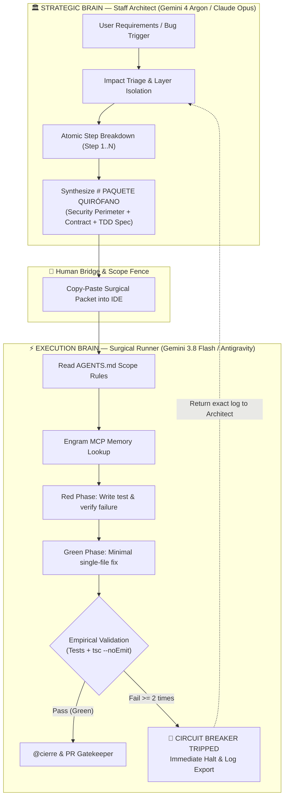
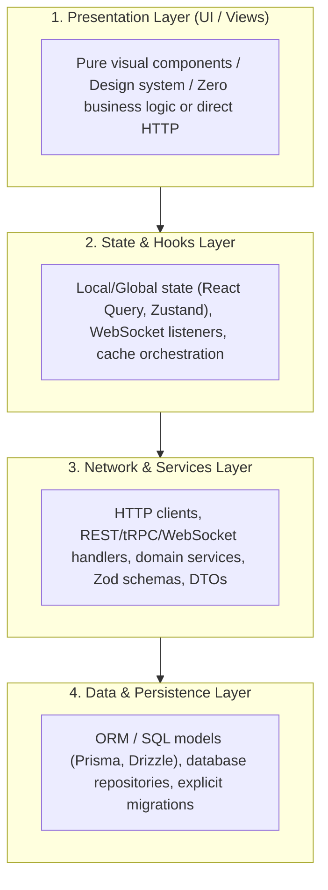

<div align="center">

# Gentle AI Harness 🛡️⚡
### The Surgical Multi-Agent Development Operating System for Solo Engineers

<p align="center">
  <a href="./README.md"></a>
  <a href="./README.es.md"></a>
</p>

[](#-profile-aware-layered-architecture)
[](#-the-one-man-engineering-team-pattern)
[](https://github.com/gentle-ai)
[](#-the-surgical-execution-protocol)
[](#-anti-token-maxing--safety-fencing)
[](https://opensource.org/licenses/MIT)

</div>

> [!TIP]
> 🌐 **Read this in other languages / Leer en otros idiomas:**
> * 🇪🇸 **[Español (README.es.md)](./README.es.md)** — Documentación completa en Español
> * 🇺🇸 **English (README.md)** — Default English version

> **"Stop letting AI codebases collapse under token-maxing, hallucinated diffs, and context drift. Gentle AI Harness couples a cloud Staff Architect with a sandboxed local executor through immutable security perimeters, deterministic TDD, and persistent memory."**

**Gentle AI Harness** is a production-grade operational framework and contract system designed to turn solo developers into a full-scale, resilient engineering organization. By separating **Strategic System Architecture** from **Surgical Code Execution**, the harness eliminates the most rampant pitfalls of modern AI assisted coding: context exhaustion, bloated diffs, contract regressions, and silent layer contamination.

---

## ⚡ The Core Problem: Why Modern AI Coding Breaks Down

Most developers interact with AI models as monolithic executors: they paste an entire task, let the model read dozens of files, and pray the generated code compiles. At scale, this causes four catastrophic failures:

1. **Token Maxing & Hallucination:** Models read hundreds of unnecessary files, burning context budgets and losing track of domain invariants.
2. **Context Drift:** As conversations grow, instructions and rules are progressively forgotten or overridden.
3. **Layer Contamination:** Monolithic agents mix SQL queries inside React UI components, bypass domain services, and hardcode secrets.
4. **Infinite Fix Loops:** When a test or typecheck fails, naive agents guess patches frantically, degrading the codebase until the branch is ruined.

**Gentle AI Harness solves this structurally through bounded execution, strict contracts, and a dual-brain topology.**

---

## 🧠 The "One-Man Engineering Team" Pattern

The harness distributes cognitive load across two specialized roles coordinated by the developer:



| Dimension | Monolithic Chat Assistants | Cloud Auto-Dev Runners | **Gentle AI Harness** |
| :--- | :--- | :--- | :--- |
| **Cognitive Division** | 1 model does architecture + code | Blind agent loops | **Staff Architect (Argon) + Surgical Runner (Flash)** |
| **Token Consumption** | Maxes out context window rapidly | High cloud consumption | **Minimalist / Anti-Token Maxing (`rg` + Engram MCP)** |
| **Scope Boundary** | Open filesystem read/write | Containerized but unguided | **Strict Cerco de Seguridad (Whitelist files only)** |
| **Failure Recovery** | Guesses until files are corrupted | Restarts whole workflow | **Circuit Breaker: halts after 2 consecutive failures** |
| **Memory Persistence** | Lost between chat sessions | Ephemeral run caches | **Permanent graph via Engram MCP** |
| **Architectural Rigor** | Spaghetti layers | Inconsistent boundaries | **Profile-aware layered architecture (`production` / `mvp`)** |

---

## 🏛️ Profile-Aware Layered Architecture

The harness detects your project profile during `@init` and applies the appropriate layer rules:

**`production` profile** (projects with > 10 logic files) — strict 4-layer separation, mandatory:



1. **UI / View Layer:** Visual presentation only. **Zero direct HTTP requests or database operations.**
2. **Hooks / State Layer:** State lifecycle, caching, optimistic mutations, and subscriptions.
3. **Network / Services / API Layer:** Domain validations (Zod), DTO transformations, endpoints, and external service contracts.
4. **Data / Persistence Layer:** Storage schemas, transactional boundaries, and migration scripts. Zero direct UI access.

**`mvp` profile** (projects with ≤ 10 logic files) — layers 1–2 may collapse into a single stateful component; layers 3–4 may unify into a flat service file. The profile auto-graduates to `production` when the threshold is exceeded or the developer explicitly runs `@perfil production`.

> **Known design constraint — the Human Bridge:** the Architect → Executor flow requires the developer to manually copy-paste Surgical Packets between the cloud chat and the local IDE. This is an intentional trade-off: operational control over raw automation speed. Use `@quick` for trivial changes to bypass the full ritual.

---

## 🛡️ Anti-Token Maxing & Safety Fencing

The harness enforces strict rules defined in [`AGENTS.md`](./AGENTS.md):

* **Memory First (`Engram MCP`):** Queries persistent project graph memory before scanning the repository.
* **Security Perimeter (`Cerco de Seguridad`):** The local agent operates under three distinct scopes — never conflated:
  * **Modification scope:** files the agent may read and write (declared in the Surgical Packet).
  * **Read-only scope:** contract/type files the agent may consult but never modify.
  * **Validation scope:** global commands (`tsc --noEmit`, full test suite) that run against the entire project without granting the agent modification rights outside the perimeter.
* **Surgical Grepping:** Cross-references are tracked using targeted CLI searches (`rg`, `grep -rn`) instead of reading full files.
* **Circuit Breaker (Anti-Loop Brake):** If any unit test or `npx tsc --noEmit` fails **twice consecutively**, execution stops instantly. Hallucination and brute-force patching are prevented by design.
* **Immutable Prohibitions:**
  * No direct commits to `main` (feature/bugfix branches only).
  * No `package.json` package additions without express approval.
  * No touching `.env` or leaking secrets in logs.
  * No database schema alterations without explicit, human-reviewed migrations.

---

## ⚡ Dynamic Routing Commands (`AGENTS.md`)

The agent operates on a **Lazy-Loading Protocol**. Rule files inside `.ai/` are never pre-loaded into context. They are only loaded on demand when the corresponding trigger command is typed:

| Trigger | Agent / Workflow | Description |
| :--- | :--- | :--- |
| `@init` | `.ai/workflows/00-init-gentle.md` | Initializes Engram node and captures repository radiography. |
| `@bug [error/desc]` | `impact-scout.md` + `01-pack-bug.md` | Pinpoints source lines via `rg` and prepares bug triage pack. |
| `@feature [req]` | `impact-scout.md` + `02-pack-feature.md` | Analyzes dependency impact and generates feature scope pack. |
| `@db [schema change]` | `03-db-migration.md` | Generates safe, reversible zero-downtime DB migration steps. |
| `@refactor [path]` | `04-refactor-aislado.md` | Isolates and refactors a module while preserving external invariance. |
| `@cierre` or `@pr` | `code-reviewer.md` + `05-gatekeeper-pr.md` | Audits git diff, runs global regression checks, and generates the PR. |
| `@quick [desc]` | Direct minimal fix | For **semantically low-risk** changes only (copy, style, labels). Skips TDD ritual. The agent confirms the diff before committing. |
| `# PAQUETE QUIRÓFANO` | Section 3 Golden Rules | Automatically activates the surgical TDD execution mode. |

---

## 📦 Anatomy of a Surgical Packet (`# PAQUETE QUIRÓFANO`)

When the Staff Architect creates an execution unit, it outputs an atomic block tailored for the local runner:

```markdown
# PAQUETE QUIRÓFANO — [TASK TITLE / STEP X of Y]

## 1. BRANCH & CONTEXT SCOPE (STRICT SECURITY PERIMETER)
- **Git Branch:** `feature/auth-session-recovery`
- **Engram Node:** `auth-service`
- **IN-SCOPE FILES (Read/Write Permitted):**
  - `src/services/auth.service.ts`
  - `src/services/auth.service.test.ts`
- **READ-ONLY CONTRACTS (Types):**
  - `src/types/auth.types.ts`
- **FORBIDDEN FILES:** Reading or modifying any other file is strictly prohibited.

## 2. IMMUTABLE CONTRACT & BACKWARD COMPATIBILITY
```typescript
export interface SessionRecoveryPayload {
  readonly sessionId: string;
  readonly token: string;
  readonly clientFingerprint?: string;
}
```

## 3. TDD EXECUTION SEQUENCE
### Step 1: Red Phase
Implement failing test in `src/services/auth.service.test.ts`. Verify test fails (RED).

### Step 2: Green Phase
Implement minimum viable logic in `src/services/auth.service.ts` to pass the test (GREEN).

### Step 3: Empirical Validation
- `npm test src/services/auth.service.test.ts` (Pass)
- `npx tsc --noEmit` (Pass)
```

---

## 📂 Repository Directory Layout

```text
gentle-ai-harness/
├── .ai/
│   ├── ARGON-TECH-LEAD.md       # Master prompt for Staff Architect (Gemini 4 Argon)
│   ├── agents/
│   │   ├── code-reviewer.md     # Security, architecture, and debt auditor
│   │   ├── documentador.md      # API contract and architectural documentation
│   │   └── impact-scout.md      # Precision grep & dependency impact investigator
│   └── workflows/
│       ├── 00-init-gentle.md    # Workspace bootstrap & Engram telemetry sync
│       ├── 01-pack-bug.md       # Bug analysis and triage pack generator
│       ├── 02-pack-feature.md   # Feature dependency and contract generator
│       ├── 03-db-migration.md   # Zero-downtime database migration workflow
│       ├── 04-refactor-aislado.md # Isolated refactoring with invariant tests
│       └── 05-gatekeeper-pr.md  # Final regression, Engram persistence & PR builder
├── AGENTS.md                    # Primary Router & Surgical Operating Contract
├── SPEC.md                      # BDD Acceptance Criteria & Scope Charter template
├── POLICY.example.json          # Reference schema contract for Runtime Policy Engines
├── .gitignore                   # Clean development environment exclusions
└── README.md                    # Project documentation
```

---

## 🚀 Quick Start: Installing into Your Project

To equip any repository with the Gentle AI Harness:

```bash
# 1. Clone the harness or copy .ai/ and AGENTS.md to your project root
cp -r .ai /path/to/your/project/
cp AGENTS.md /path/to/your/project/
cp SPEC.md /path/to/your/project/

# 2. Open your project in Google Antigravity or your AI IDE
# 3. Paste the contents of .ai/ARGON-TECH-LEAD.md into your Web Architect (Gemini 4 Argon / Claude 3.5 Sonnet)
# 4. In your local agent chat, run:
@init
```

The harness immediately calibrates your local executor, aligns persistent memory via Engram, and enforces the surgical boundary on all subsequent tasks.

---

## 📜 License

Distributed under the **MIT License**. Feel free to use, modify, and integrate this harness into your proprietary or open-source software engineering toolchains.
